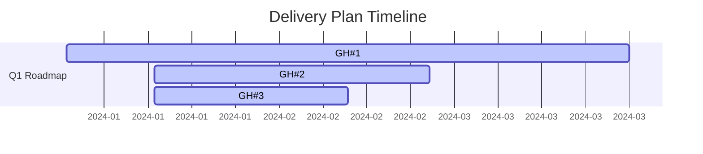

# ADO → GHE Migration Tool - Enhanced Features

## Overview

The enhanced migration tool extends the original ADO-to-GitHub migration with comprehensive support for:

1. **Work Item Relationships** - Parent/Child hierarchies and dependencies
2. **Sprints & Iterations** - Sprint assignment and backlog tracking  
3. **Saved Queries** - Conversion to GitHub search labels
4. **Delivery Plans** - Timeline exports (CSV, Mermaid, Markdown)
5. **Full Backlog Hierarchy** - Epic→Feature→Task tracking

---

## 1. Work Item Relationships (`relations.py`)

### What Gets Migrated

Azure DevOps work item relationships are converted to GitHub issue links:

| ADO Relation Type | GitHub Equivalent | Representation |
|-------------------|-------------------|-----------------|
| Parent/Child      | BLOCKS            | Parent issue blocks child |
| Dependency        | BLOCKED_BY        | Issue blocked by another  |
| Related To        | RELATES_TO        | Cross-reference          |

### How It Works

1. **Fetch hierarchy** from ADO using the Relations API
2. **Build mapping** of parent/child/dependency relationships
3. **Create GitHub links** via GraphQL `createIssueLink` mutation
4. **Store metadata** in custom project fields if using Projects v2

### Example: Epic → Feature → Task

```
ADO:
  Epic #1001 "User Authentication"
    └─ Feature #1002 "OAuth Integration"  
       ├─ Task #1003 "Implement OAuth provider"
       └─ Task #1004 "Add tests"

GitHub (after migration):
  Issue #1 "User Authentication" [type:epic]
    └─ Blocks Issue #2 "OAuth Integration" [type:feature]
       ├─ Blocks Issue #3 "Implement OAuth provider" [type:task]
       └─ Blocks Issue #4 "Add tests" [type:task]
```

### Usage

The relations migration happens automatically in step 7:

```bash
python migrate.py                    # Include relations by default
python migrate.py --skip-relations   # Exclude relations
```

### Verification

Check GitHub issue links:
- Open any issue in GitHub
- Scroll to "Linked issues" section
- Relationships should show as "blocks", "is blocked by", "relates to"

---

## 2. Sprints & Iterations (`sprints.py`)

### What Gets Migrated

- **Sprint names** → GitHub milestones
- **Sprint dates** → Milestone description
- **Work item assignments** → Issue milestone + custom "Sprint" field
- **Sprint status** (active/past/future) → Metadata
- **Backlog items** → Tracked separately

### How It Works

1. **Fetch sprints** from each ADO team via Iterations API
2. **Create milestones** for each sprint in GitHub
3. **Assign issues** to milestones based on iteration path
4. **Track unassigned** items (true backlog)

### Example Sprint Migration

```
ADO Sprints:
  Project "MyApp" / Team "Backend"
    ├─ Sprint 2024-Q1
    ├─ Sprint 2024-Q2
    └─ Sprint 2024-Q3

GitHub Milestones:
  ├─ 2024-Q1 (milestone #1)
  ├─ 2024-Q2 (milestone #2)
  └─ 2024-Q3 (milestone #3)

Work Item → Milestone Assignment:
  ADO Issue #1005 (iteration="2024-Q2") 
    → GitHub Issue #5 (milestone=2024-Q2)
```

### Usage

Sprints migrate automatically in step 8:

```bash
python migrate.py                   # Include sprints
python migrate.py --skip-sprints    # Exclude sprints
```

### Verification

Check GitHub milestones:
1. Go to repo → Milestones
2. Each ADO sprint should appear as a milestone
3. Check milestone progress (X of Y issues closed)
4. Review issue assignments to sprints

---

## 3. Saved Queries (`queries.py`)

### What Gets Exported

Azure DevOps saved queries are converted to:

1. **Label combinations** - GitHub search filters
2. **JSON mapping** - `query_map.json` with all conversions
3. **Markdown guide** - `GITHUB_FILTERS.md` with search instructions

### Conversion Rules

```
WIQL                                      → GitHub Labels
─────────────────────────────────────────────────────────
[System.State] = 'Active'                → state:active
[System.WorkItemType] = 'Bug'             → type:bug
[System.Priority] = '1'                   → priority:1
[System.Tags] CONTAINS 'urgent'           → tag:urgent
[System.AreaPath] = 'Backend'             → area:backend
```

### Example Query Migration

**Original ADO Query:**
```sql
SELECT [System.Id], [System.Title] 
FROM WorkItems
WHERE [System.State] = 'Active'
  AND [System.WorkItemType] = 'Bug'
  AND [Microsoft.VSTS.Common.Priority] = '1'
ORDER BY [System.CreatedDate] DESC
```

**Converted to GitHub Search:**
```
label:"type:bug" label:"state:active" label:"priority:1"
```

**GitHub URL:**
```
https://github.com/owner/repo/issues?q=label%3Atype%3Abug+label%3Astate%3Aactive+label%3Apriority%3A1
```

### Usage

Queries export automatically in step 9a:

```bash
python migrate.py                  # Export queries
python migrate.py --skip-queries   # Skip query export
```

### Output Files

1. **`query_map.json`** - Machine-readable mapping
   ```json
   {
     "queries": [
       {
         "name": "Active Bugs",
         "path": "Shared Queries/Bugs",
         "wiql": "...",
         "github_labels": ["type:bug", "state:active"],
         "github_search": "label:\"type:bug\" label:\"state:active\""
       }
     ]
   }
   ```

2. **`GITHUB_FILTERS.md`** - Human-readable guide
   - Lists each saved query
   - Shows original WIQL
   - Provides GitHub search equivalent
   - Includes clickable GitHub URLs

### Verification

1. Check `GITHUB_FILTERS.md` for all query conversions
2. Try searches in GitHub UI using provided labels
3. Verify results match original ADO query intent

---

## 4. Delivery Plans (`delivery_plans.py`)

### What Gets Exported

Azure DevOps Delivery Plans (timeline views) are exported as:

1. **CSV timeline** - `timeline.csv` (for spreadsheets/analytics)
2. **Mermaid diagram** - `timeline.mmd` (for visual timeline)
3. **Markdown roadmap** - `ROADMAP.md` (for documentation)
4. **Critical path** - `critical_path.json` (dependencies)

### CSV Format

```csv
ADO_ID,GitHub_Issue,Title,Type,Start_Date,End_Date,Status,Plan
1001,#1,"User Auth System",Epic,2024-01-01,2024-03-31,In Progress,Q1 Roadmap
1002,#2,"OAuth Integration",Feature,2024-01-15,2024-02-28,In Progress,Q1 Roadmap
1003,#3,"Implement OAuth",Task,2024-01-15,2024-02-15,In Progress,Q1 Roadmap
```

### Mermaid Gantt Diagram



### Markdown Roadmap

```markdown
## Q1 Roadmap

| Item | GitHub | Type | Timeline | Status |
|------|--------|------|----------|--------|
| User Auth System | #1 | Epic | 2024-01-01 → 2024-03-31 | In Progress |
| OAuth Integration | #2 | Feature | 2024-01-15 → 2024-02-28 | In Progress |
```

### Usage

Delivery plans export automatically in step 9b:

```bash
python migrate.py                          # Export delivery plans
python migrate.py --skip-delivery-plans    # Skip export
```

### Output Files

| File | Format | Use Case |
|------|--------|----------|
| `timeline.csv` | CSV | Import to Excel, dashboards, analytics |
| `timeline.mmd` | Mermaid | Include in docs, view in GitHub |
| `ROADMAP.md` | Markdown | Add to repo README or wiki |
| `critical_path.json` | JSON | Dependency analysis |

### Verification

1. Open `timeline.csv` in Excel/spreadsheet - verify dates and titles
2. Preview `timeline.mmd` in GitHub - visual timeline should render
3. Check `ROADMAP.md` - roadmap should be readable in docs
4. Review `critical_path.json` - verify critical dependencies

---

## Running the Enhanced Migration

### Prerequisites

```bash
# Install enhanced modules (same as original)
pip install python-dotenv requests markdownify

# .env file must contain:
ADO_ORG=your-ado-org
ADO_PROJECT=your-ado-project
ADO_PAT=your-ado-token
GITHUB_TOKEN=your-github-token
GITHUB_OWNER=your-github-user-or-org
GITHUB_REPO=your-github-repo
GITHUB_ORG=your-github-org  # if owner is org
```

### Basic Migration (All Features)

```bash
# Full migration with all enhancements
python migrate.py
```

**Steps executed:**
1. Fetch work item IDs from ADO
2. Fetch work item details
3. Sync GitHub labels
4. Prepare attachment release
5. Create GitHub issues
6. Migrate boards → GitHub Projects
7. **[NEW]** Migrate work item relationships
8. **[NEW]** Migrate sprints & iterations
9. **[NEW]** Export saved queries
10. **[NEW]** Export delivery plans

### Selective Feature Control

```bash
# Skip specific features
python migrate.py --skip-attachments --skip-relations

# Only migrate certain features
python migrate.py --skip-boards --skip-sprints --skip-queries

# Dry-run to preview
python migrate.py --dry-run

# Resume from specific work item
python migrate.py --resume-from 5000 --limit 100

# Only update boards (issues already done)
python migrate.py --board-only
```

### Available Flags

```
--dry-run                   Test run without writing to GitHub
--limit N                   Migrate max N work items
--resume-from N            Resume from work item ID N
--skip-attachments         Skip file uploads
--skip-boards              Skip board/project migration
--skip-sprints             Skip sprint/iteration migration
--skip-relations           Skip work item relationships
--skip-queries             Skip query conversion
--skip-delivery-plans      Skip delivery plan export
--board-only               Only migrate boards (issues already done)
```

---

## Output Files & Artifacts

After running the enhanced migration, check for:

### In your repo root:
- `migration.log` - Full migration log
- `migration_progress.json` - Resume data
- `query_map.json` - **[NEW]** Saved query mappings
- `GITHUB_FILTERS.md` - **[NEW]** Search filter guide
- `timeline.csv` - **[NEW]** Delivery plan timeline
- `timeline.mmd` - **[NEW]** Gantt diagram
- `ROADMAP.md` - **[NEW]** Markdown roadmap
- `critical_path.json` - **[NEW]** Critical dependencies

### In GitHub:
- Issues with relationships linked
- Milestones for each sprint
- Labels for query conversions
- Projects with status fields

---

## Troubleshooting

### Relations not showing up

**Problem:** GitHub issue links aren't appearing
**Solution:**
1. Check `migration.log` for errors in step 7
2. Verify parent/child IDs in `migration_progress.json`
3. Ensure target GitHub issues exist
4. Try `--dry-run` to preview link operations

### Sprints not assigned

**Problem:** Issues not appearing in milestone
**Solution:**
1. Check `migration_progress.json` → `sprints` section
2. Verify ADO iteration paths are set on work items
3. Check GitHub milestones were created (repo → Milestones)
4. Manually assign issues to milestones if needed

### Query conversion incomplete

**Problem:** Some saved queries aren't in `query_map.json`
**Solution:**
1. Check `GITHUB_FILTERS.md` - may show "no labels found"
2. Some WIQL patterns aren't recognized (add to `queries.py`)
3. Use `suggest_labels_for_search()` helper for complex queries

### Delivery plan timeline missing dates

**Problem:** `timeline.csv` has blank Start_Date/End_Date
**Solution:**
1. Check ADO delivery plan configuration
2. Some work items may not have dates in ADO
3. Mermaid diagram will show "TBD" for missing dates

---

## Architecture

### Module Relationships

```
migrate.py (orchestrator)
├── relations.py (work item links)
├── sprints.py (iterations → milestones)
├── queries.py (WIQL → GitHub labels)
├── delivery_plans.py (timeline exports)
├── boards.py (existing board migration)
├── gh_projects.py (existing GitHub Projects v2)
├── attachments.py (existing file uploads)
└── migrate.py (original work item migration)
```

### Data Flow

```
ADO APIs
  ├─→ relations.py → GitHub GraphQL API
  ├─→ sprints.py → GitHub REST API (milestones)
  ├─→ queries.py → JSON/Markdown exports
  ├─→ delivery_plans.py → CSV/Mermaid/Markdown exports
  └─→ [original modules]

GitHub
  ├─ Issues with linked relationships
  ├─ Milestones for sprints
  ├─ Labels for query conversions
  └─ Projects with fields
```

---

## Performance & Limits

### Rate Limiting

- ADO API: 200 item batch size (auto-paginated)
- GitHub REST: 5,000/hr core rate limit
- GitHub GraphQL: Standard rate limits (built-in delays: 0.4-0.8s per operation)
- Relationship creation: 0.5s delay per link

### Estimated Times

| Feature | Time per 1000 Items |
|---------|-------------------|
| Basic migration | 10-15 min |
| + Relationships | +5-10 min |
| + Sprints | +2-3 min |
| + Full export | +1-2 min |

---

## Next Steps After Migration

1. **Review migrated content** - Check GitHub for data accuracy
2. **Update team documentation** - Point to new GitHub searches
3. **Archive ADO project** - Keep for reference/audit
4. **Configure GitHub views** - Create custom saved filters
5. **Train team** - Share `GITHUB_FILTERS.md` guide

---

## Support & Examples

### Finding Issues by Type

```bash
# Use labels from query conversions
label:"type:bug" label:"state:active"        # Active bugs
label:"type:epic"                             # All epics
label:"priority:1" label:"state:active"      # Critical active issues
```

### Viewing Delivery Timeline

```bash
# In VS Code, use Mermaid preview
code timeline.mmd

# Or view on GitHub wiki
# Add timeline.mmd to repo wiki as code block
```

### Analyzing Dependencies

```bash
# View critical path JSON
cat critical_path.json | jq '.[] | {title, urgency}'

# Filter for high-urgency items
cat critical_path.json | jq '.[] | select(.urgency == "high")'
```

---

## Advanced Configuration

### Custom Field Mapping (in `queries.py`)

To add custom conversions:

```python
FIELD_MAPPING = {
    'Custom.MyField': {
        'Value1': 'custom:value1',
        'Value2': 'custom:value2',
    }
}
```

### Custom Relationship Types (in `relations.py`)

To add more ADO relation types:

```python
elif rel_type == "Custom.MyRelationType":
    hierarchy[wi_id]['custom_relations'].append(target_id)
```

---

## FAQ

**Q: Can I migrate to a different GitHub repo?**  
A: Yes, just change `GITHUB_OWNER` / `GITHUB_REPO` in .env

**Q: What if ADO has links to external systems?**  
A: External links are preserved in issue descriptions as comments

**Q: Can I re-run the migration?**  
A: Yes, `migration_progress.json` tracks completed work (use `--resume-from`)

**Q: How do I handle broken links after migration?**  
A: Check `migration.log` for warnings; some relations may fail if target items weren't migrated

**Q: Can I customize the GitHub Projects structure?**  
A: Yes, modify `gh_projects.py` to add/change custom fields

---

## License & Support

This enhanced tool is provided as-is. For issues:
1. Check logs in `migration.log`
2. Verify .env configuration
3. Test with `--dry-run` first
4. Review output JSON files for data validation

---

*Last updated: May 2026*
