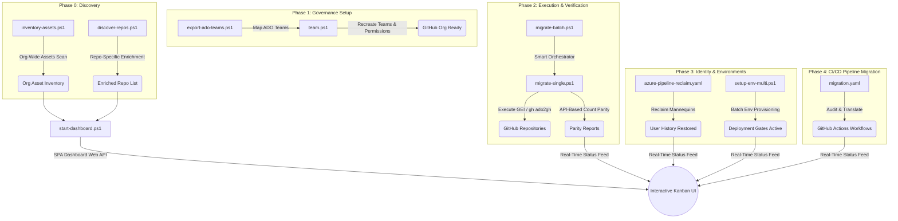

# Building an Enterprise-Grade Azure DevOps to GitHub Migration Engine

## A PowerShell and CI/CD Automation Framework for Seamless Repository, Pipeline, and Governance Migrations

---

*Moving hundreds of repositories, build/release pipelines, deployment environments, and team hierarchies from Azure DevOps (ADO) to GitHub is not a simple copy-paste job. It is a complex migration project that requires preserving historical commit attribution, re-establishing security boundaries, translating CI/CD workflows, and verifying data parity. This article details a custom-built, enterprise-grade automation framework designed to handle this transition end-to-end.*

---

## The Migration Challenge at Scale

When migrating at scale, teams often face a set of common bottlenecks:
- **Lost Governance**: Branch protections, deployment gates, and approvers do not natively transfer.
- **Commit Anonymization**: Committers' ADO profiles appear as unlinked placeholder "mannequins" in GitHub.
- **Classic to YAML translation**: Classic ADO release definitions need to be restructured into modern CI/CD formats.
- **Tooling Instability**: Network flakiness or rate limits (HTTP 429) can cause batch migration tools to fail mid-run.
- **Loss of Parity Visibility**: Manually verifying that branch, tag, and commit counts match across hundreds of repositories is highly error-prone.

To solve these challenges, we built the **Migration Accelerator Board and Engine**—a modular PowerShell and CI/CD suite that automates every phase of the migration lifecycle.



---

## Phase 0: Deep Discovery and Asset Inventory

Before copying a single byte, you must understand your source landscape. The framework breaks discovery into two distinct layers:

### 1. Broad Organization Inventory (`inventory-assets.ps1`)
This script executes a full traversal of the ADO organization. Using parallel calls to the ADO REST API (API version `7.1`), it extracts:
*   Git repository counts and sizes (flagging repositories **>1 GB** as warnings and **>40 GB** as blockers for the GitHub Enterprise Importer).
*   Classic build definitions vs. YAML pipeline configurations.
*   Classic release definitions and their target environment configurations.
*   Service connections, variable groups (flagging Azure Key Vault bindings), and team structures.

### 2. Deep Repository Discovery (`discover-repos.ps1`)
A targeted script that enriches the repository inventory list. In addition to metadata, it checks for:
*   **Git LFS usage** by making lightweight API calls to detect `.gitattributes` files containing LFS filter declarations (`filter=lfs`).
*   **Activity metrics** by fetching the committer date of the latest commit on the default branch, separating active projects from archival ones.

### Code Highlight: Lightweight LFS and Commit Auditing
Rather than performing a heavy `git clone` for every repository during discovery, the script queries the ADO REST API directly:

```powershell
# Check for .gitattributes LFS markers via API without cloning
try {
    $gitattrsUrl = "$adoOrg/$adoProj/_apis/git/repositories/$($repo.id)/items?path=.gitattributes&api-version=7.1"
    $gitattrs = Invoke-RestMethod -Uri $gitattrsUrl -Headers $headers -Method Get -ErrorAction SilentlyContinue
    if ($gitattrs -match 'filter=lfs') { $hasLfs = $true }
}
catch {
    # No .gitattributes exists — repo does not use LFS
}
```

---

## Phase 1: Recreating Organization Governance

Permissions and team structures represent the security posture of your organization. The scripts `export-ado-teams.ps1` and `team.ps1` map this hierarchy automatically.

1.  **Export**: `export-ado-teams.ps1` extracts all teams, their user rosters, and descriptions from the ADO organization.
2.  **Mapping**: It cross-references email addresses to generate a structured JSON team mapping file.
3.  **Recreation**: `team.ps1` logs into GitHub via the GitHub CLI (`gh`) and recreates these teams, handles nested team hierarchies, and assigns corresponding repository access permissions.

---

## Phase 2: The Migration Engine with Smart Recovery

At the heart of the framework is `migrate-single.ps1` and its batch orchestrator `migrate-batch.ps1`. These scripts call the GitHub Enterprise Importer (GEI) CLI extension (`gh ado2gh`) to execute the migrations.

### Resilience Patterns in `migrate-single.ps1`
1.  **Duplicate Check**: Pre-checks target existence using `gh repo view`. If the repository already exists or is a redirect, it handles it gracefully instead of failing.
2.  **Smart Retries with Exponential Backoff**: Migration runs are wrapped in a robust retry loop. If a network interruption, connection reset, or rate limit (`429`) is detected, the script backs off (waiting `attempt * 60` seconds) before retrying.
3.  **"Already Queued" Status Handling**: If the GEI API indicates a migration is already queued, the script transitions to a polling state, checking the target status for up to 30 minutes.
4.  **Branch Exclusion Cleanup**: Automatically purges temporary, stale, or excluded branches post-migration to keep the target repository clean.

```powershell
# Exponential Backoff Retry Logic for API and Network Flakiness
$maxAttempts = 3
$success = $false

for ($attempt = 1; $attempt -le $maxAttempts; $attempt++) {
    if ($attempt -gt 1) {
        $waitTime = $attempt * 60
        Write-Host "Waiting $($waitTime)s before retry attempt $attempt/$maxAttempts..." -ForegroundColor Yellow
        Start-Sleep -Seconds $waitTime
    }

    $migState = "EXPORTING"
    $migOutput = gh ado2gh migrate-repo `
        --ado-org $ADOOrg `
        --ado-team-project $ADOProject `
        --ado-repo $ADORepo `
        --github-org $GHOrg `
        --github-repo $GHRepo `
        --target-repo-visibility $TargetRepoVisibility 2>&1

    if ($LASTEXITCODE -eq 0) {
        $migState = "COMPLETE"; $success = $true; break
    }
    elseif (($migOutput -join "") -match "already been queued") {
        # Transition to polling loop...
        break
    }
    elseif (($migOutput -join "") -match "timeout|network|connection reset|429|502") {
        Write-Warning "Network/Timeout error detected on attempt $attempt."
    }
    else {
        $migState = "FAILED"; break # Permanent failure (e.g. auth/scopes)
    }
}
```

### High-Speed Parity Validation
Once GEI reports a successful migration, `migrate-single.ps1` performs an API-based validation step. Instead of cloning the repositories locally (which is slow and bandwidth-intensive), it queries the ADO REST API and the GitHub REST/GraphQL APIs to compare:
*   Total branch counts and branch lists.
*   Tag counts and names.
*   Default branch names.
*   Total commit counts on the default branch (using GitHub GraphQL paginated history requests).
*   Pull Request counts (broken down by source and target branches).

It generates an HTML dashboard page and CSV report detailing exactly how many files, folders, commits, and branches were successfully transferred.

---

## Phase 3: Identity Restoration and Mannequin Reclaiming

A major challenge during migration is that commit histories are mapped to email addresses that may not exist in GitHub, leaving historical commits attributed to unlinked placeholder identities called **mannequins**.

The script `azure-pipeline-reclaim.yaml` runs a three-stage automated pipeline to link historical metadata with active GitHub user accounts:

```
[Phase 1: List Mannequins]
       │
       ▼
   gh ado2gh generate-mannequin-csv
       │
       ▼
   Match users via user-mappings.csv (Email/Username/Display Name)
       │
       ▼
[Phase 2: Review Gate]
       │
       ▼
   Manual Validation Gate in Pipeline (Confirm matches)
       │
       ▼
[Phase 3: Execute Reclaim]
       │
       ▼
   gh ado2gh reclaim-mannequin --csv reclaim-input.csv --force
```

This ensures that every historical commit, pull request, and comment is accurately attributed to the correct developer's active GitHub profile.

---

## Phase 4: Recreating CI/CD Environment Governance

Azure DevOps Release Pipelines use environments to lock down deployments with branch restrictions, manual approvals, and wait timers. Since these do not transfer automatically, we developed `setup-env-multi.ps1` to re-establish this governance.

Driven by a declarative configuration file (`repos.csv`), the script processes each repository's environments:
1.  **Idempotent Execution**: It queries the existing deployment branch policies on GitHub and deletes matching stale configurations to prevent duplicates on script re-runs.
2.  **Reviewer Resolution**: Resolves reviewer usernames into numeric GitHub user IDs (caching IDs in memory to stay within API rate limits).
3.  **Deployment Policy Creation**: Configures target environments, sets custom branch rules, attaches designated reviewers, and configures deployment wait times.

```powershell
# Set up a GitHub environment with branch restrictions and reviewers
$envConfig = @{
    wait_timer = $WaitTimer
    deployment_branch_policy = @{
        protected_branches = $false
        custom_branch_policies = $true
    }
    reviewers = $resolvedReviewers # Array of @{ type="User"; id=$userId }
}

$jsonPayload = $envConfig | ConvertTo-Json -Depth 5
# Write BOM-free JSON to avoid GitHub API 400 errors
[System.IO.File]::WriteAllText($tempJsonPath, $jsonPayload)

Invoke-GhApi -Method PUT -Endpoint "repos/$GHOrg/$Repo/environments/$EnvName" -InputFile $tempJsonPath
```

---

## Phase 5: Pipeline Migration (`migration.yaml`)

Converting ADO pipelines to GitHub Actions is handled by `migration.yaml`. It automates:
*   **Pipeline Auditing**: Scanning current pipeline definitions to inventory dependencies.
*   **Variable Extraction**: Parsing ADO variables and mapping them to GitHub secrets or variables.
*   **Centralized Reusable Templates**: A specialized step (`MigrateReusables`) detects shared ADO templates, migrates them to a centralized GitHub repository, and rewrites downstream workflow files to refer to the central reusable workflow actions.

---

## Command Center: The Interactive Kanban Dashboard

For operators managing the migration, we created the **ADO Migration Accelerator Board**—a clean, dark-mode single-page application (SPA).

```
┌────────────────────────────────────────────────────────┐
│  ADO MIGRATION ACCELERATOR BOARD                        │
├────────────────────────────────────────────────────────┤
│  [ Dashboard Overview ] [ Kanban Board ] [ Configure ] │
├────────────────────────────────────────────────────────┤
│  KANBAN BOARD                                          │
│  ┌──────────┐ ┌──────────┐ ┌───────────┐ ┌───────────┐ │
│  │ Backlog  │ │ Prepped  │ │ Migrating │ │ Completed │ │
│  │ ──────── │ │ ──────── │ │ ───────── │ │ ───────── │ │
│  │ Repo-A   │ │ Repo-B   │ │ Repo-C    │ │ Repo-D    │ │
│  │ Repo-E   │ │          │ │ (Running) │ │ (Pass)    │ │
│  └──────────┘ └──────────┘ └───────────┘ └───────────┘ │
└────────────────────────────────────────────────────────┘
```

The dashboard frontend is styled with modern CSS features (radial glow backgrounds, glassmorphic card containers, and smooth transitions) and is powered by a zero-dependency backend web server (`start-dashboard.ps1`) written entirely in PowerShell.

### The PowerShell HTTP Web Server Engine
The backend web server uses the native `System.Net.HttpListener` class to serve files and handle API requests. It interfaces directly with the migration scripts:
*   **`/api/config`**: Reads and writes configurations (hiding passwords and personal access tokens).
*   **`/api/status`**: Gathers inventory, validation results, and batch execution records, parsing them to dynamically place repositories in the correct Kanban column (Backlog, Prepped, Migrating, Completed, or Blocked).
*   **`/api/run`**: Spawns migration runs as background processes (using `Start-Process` to run PowerShell scripts in the background).
*   **`/api/logs`**: Streams the log file of active scripts to the SPA terminal in real-time, allowing operators to monitor stdout/stderr output directly from the browser.

---

## Key Takeaways

By wrapping standard migration tools (like GEI) in a custom scripting and dashboard layer, we transformed an unstable migration process into a predictable, robust engine:
1.  **Discovery-First Approach**: Discovering sizes, LFS configurations, and legacy structures avoids failures before the migration begins.
2.  **API Parity Over Clones**: Validating counts via APIs is fast, secure, and easily scales to hundreds of repositories.
3.  **Idempotence and Retries**: Automation must assume networks fail. Building retry loops and cleanups directly into the scripts ensures reliability.
4.  **Preserved Governance**: Rebuilding teams, branch policies, and deployment gates ensures that migrated projects remain secure on day one.
