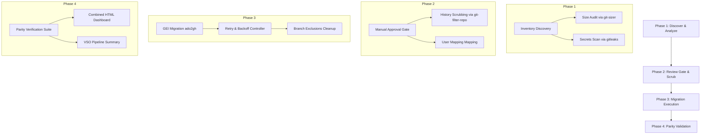

# Engineering at Scale: Building an Automated, Security-Hardened Migration Pipeline from Azure DevOps to GitHub

## Abstract
Migrating version control systems at the enterprise level is rarely as simple as a `git clone --mirror` and `git push`. Scale, network instability, organizational compliance, history sanitization, and verification parity turn what looks like a weekend project into a high-risk operational challenge. 

This paper details the design, architecture, and implementation of a declarative, four-stage migration orchestrator built to migrate Git repositories from Azure DevOps (ADO) to GitHub. The solution integrates automated repository profiling (using `git-sizer`), comprehensive secret scanning (using `gitleaks`), history scrubbing (using `git-filter-repo`), fault-tolerant migration execution (via GitHub Enterprise Importer), and a rigorous post-migration verification suite that ensures commit and structural integrity.

---

## 1. The Enterprise Migration Challenge
When moving hundreds of repositories from Azure DevOps to GitHub, manual migration strategies fail. The major hurdles fall into three categories:

1. **Compliance and Security**: Codebases often contain historical secrets (API keys, database credentials) that must be scrubbed *before* migrating to a new platform where global visibility and security controls differ.
2. **Operational Scale and Network Faults**: Network timeouts, HTTP 429 rate limits, and concurrent queue restrictions can cause migrations to fail midway. Pipelines must be resilient, supporting automated retries and status polling.
3. **Parity Verification**: Migrated repositories must match their sources exactly. Teams need absolute certainty that default branches, git tags, commit histories, and active pull requests have been migrated without loss or alteration.

To solve this, we built a modular migration engine structured around an Azure DevOps YAML pipeline and PowerShell orchestrators.



---

## 2. Phase 1: Discover and Analyze
The discovery phase acts as a static analysis gate for the source code repositories. It ensures that the migration team has full visibility into repository dimensions and security postures before a single commit is migrated.

### 2.1 Inventory Discovery
Using the Azure DevOps REST API, the pipeline scans the organization and project to discover all active Git repositories. It writes a structured metadata manifest (`repo-inventory.json`) containing repository IDs, remote URLs, and default branch configurations.

### 2.2 Repository Size Auditing
Large repositories (especially those with binary bloating or deep historical commits) can cause migrations to timeout or violate GitHub's file and repository size recommendations. 
We integrate `git-sizer` to run a deep analysis on the repository structure. If a repository exceeds a defined safety limit (e.g., > 40 GiB or containing individual blobs over 100 MiB), it is flagged as `OVER_LIMIT` and blocked from migrating until cleanup is performed.

### 2.3 Secrets Detection at Scale
Regulated environments require a zero-trust approach to embedded secrets. The engine deploys `gitleaks` across the repository inventory. In batch migrations, secret scanning is distributed across parallel matrix jobs (using Azure Pipelines multi-agent matrix) to avoid timing limits on single build agents:
- Codebases are scanned commit-by-commit.
- Detected secrets (API keys, certificates, private keys) are compiled into a central JSON report (`secret-scan-findings.json`).

---

## 3. Phase 2: Review Gate & Preparation
The discovery reports feed into a manual validation checkpoint, serving as a governance gate.

```
                   +------------------------+
                   |  Discovery Reports     |
                   |  - Repo Sizes          |
                   |  - Gitleaks Findings   |
                   +-----------+------------+
                               |
                               v
                  +------------+------------+
                  |    Manual Review Gate   |
                  +------------+------------+
                               |
            +------------------+------------------+
            |                                     |
    [Pass: Zero Findings]              [Fail: Secrets / Size Alerts]
            |                                     |
            v                                     v
+-----------+------------+            +-----------+------------+
| Proceed to Phase 3     |            |  Run History Scrubbing |
| (Migration Execution)  |            |  & Rotate Credentials  |
+------------------------+            +-----------+------------+
                                                  |
                                                  v
                                      +-----------+------------+
                                      | Force-Push Clean ADO   |
                                      | & Re-Run Discovery     |
                                      +------------------------+
```

### 3.1 History Scrubbing via git-filter-repo
If the secret scan reveals credentials in the Git history, the repository must be sanitized before proceeding. The engine includes a automated scrubbing script utilizing `git-filter-repo`. 

```powershell
# Core pattern extraction and file-level removal
foreach ($filePath in $uniqueFiles) {
    Write-Host "Removing $filePath from all history..."
    git filter-repo --invert-paths --path $filePath --force 2>&1
}
```

By targeting specific paths containing historical secrets, the history is completely rewritten. Because rewriting history alters commit hashes:
1. The cleaned history is force-pushed back to the Azure DevOps source repository.
2. A credential rotation checklist (`credential-rotation-checklist.csv`) is automatically generated, listing every compromised rule and file. Security teams use this to rotate the exposed credentials.
3. Developers are notified that they must discard their local clones and perform a fresh checkout.

---

## 4. Phase 3: Migration Execution
Once cleared by the review gate, the migration is executed using the GitHub Enterprise Importer (GEI) CLI extension (`gh-ado2gh`). 

### 4.1 Fault-Tolerant Migration Loop
Network timeouts or API rate limits can cause migrations to fail. To handle this, the migration script implements a smart retry loop with exponential backoff and specialized status polling:

```powershell
$maxAttempts = 3
$success = $false

for ($attempt = 1; $attempt -le $maxAttempts; $attempt++) {
    if ($attempt -gt 1) {
        $waitTime = $attempt * 60
        Start-Sleep -Seconds $waitTime
    }

    # Execute GitHub Enterprise Importer
    $migOutput = gh ado2gh migrate-repo `
        --ado-org          $ADOOrg `
        --ado-team-project $ADOProject `
        --ado-repo         $ADORepo `
        --github-org       $GHOrg `
        --github-repo      $GHRepo `
        --target-repo-visibility $TargetRepoVisibility 2>&1

    if ($LASTEXITCODE -eq 0) {
        $success = $true
        break
    }
    # Handle already queued migrations (wait and poll)
    elseif (($migOutput -join "") -match "already been queued") {
        # Polling logic checking gh repo view
        ...
    }
}
```

### 4.2 Branch Exclusions Cleanup
In legacy repositories, teams often want to exclude specific branches (e.g., old feature branches, temporary testing environments) from the target GitHub environment to keep it clean. 

GEI migrates all refs by default. To enforce exclusions, the engine parses the configuration file, checks the target repository via the GitHub API, and dynamically deletes the excluded refs:

```powershell
# Verify branch existence and delete via REST API
$exists = (gh api "repos/$GHOrg/$GHRepo/branches/$branch" --silent)
if ($exists) {
    gh api -X DELETE "repos/$GHOrg/$GHRepo/git/refs/heads/$branch"
}
```

---

## 5. Phase 4: Parity Validation
The critical step of the migration is proving that the target repository is structurally identical to the source. The orchestrator runs a multi-point verification suite evaluating nine metrics:

| Metric | Source API | Target API | Verification Logic |
| :--- | :--- | :--- | :--- |
| **Repo Existence** | N/A | GitHub CLI `gh repo view` | Confirms target is provisioned |
| **Branch Count** | ADO `/refs?filter=heads/` | GitHub REST `/branches` | Parity comparison with 1% tolerance for large repos |
| **Missing Branches** | List of ADO branch names | List of GitHub branch names | Identifies if any branch failed to migrate |
| **Default Branch** | ADO `/repositories/{id}` | GitHub REST `default_branch` | Ensures default branch setting matches |
| **Tag Count** | ADO `/refs?filter=tags/` | GitHub REST `/tags` | Ensures tag parity |
| **PR Count** | ADO `/pullrequests` (active/completed) | GitHub Search `/search/issues` | Verifies PR migration status within ±2 tolerance |
| **Visibility** | ADO Project Visibility | GitHub REST `visibility` | Matches target visibility configuration |
| **Latest Commit SHA**| Local Git metadata | GitHub REST `/commits/{sha}` | Checks that the latest default branch commit is reachable |
| **Branch Protection**| N/A | GitHub REST `/protection` | Warns if branch protection isn't configured |

### 5.1 Efficient Batch Auditing via GraphQL
Querying commit counts for hundreds of branches over standard REST APIs is expensive and leads to rate-limiting. The validator optimizes this by batching requests through the GitHub GraphQL API, fetching data for up to 50 branches in a single request:

```graphql
{
  repository(owner: "myorg", name: "myrepo") {
    b0: ref(qualifiedName: "refs/heads/main") {
      target {
        ... on Commit {
          history { totalCount }
        }
      }
    }
    b1: ref(qualifiedName: "refs/heads/dev") {
      target {
        ... on Commit {
          history { totalCount }
        }
      }
    }
  }
}
```

---

## 6. Pipeline Reporting and Dashboards
To make migration runs transparent, the validator generates three outputs:
1. **Machine-Readable Reports**: JSON (`validation-results.json`) and flat CSV logs for security auditing.
2. **Interactive HTML Dashboards**: Rich HTML pages summarizing the migration status, accuracy metrics, and branch-by-branch details, published directly on the Azure DevOps build run via the `PublishHtmlReport` task.
3. **Pipeline Summary Tab**: The validation summary is translated into Markdown and uploaded directly to the Azure DevOps build run summary page using the VSO agent logging command:

```powershell
Write-Host "##vso[task.uploadsummary]$valSummaryPath"
```

---

## 7. Lessons Learned & Best Practices

1. **Scrub Early**: Cleaning history after code has migrated to GitHub is ten times harder than cleaning it at the source. Ensure Phase 1 and Phase 2 are strictly enforced.
2. **GraphQL is Mandatory**: Standard REST APIs are too slow for large-scale Git audits. GraphQL query batching reduces verification times by over 80%.
3. **Handle Redirection**: GitHub redirects renamed repositories. Checking repo existence must check the *actual name* returned by the payload to prevent attempting to overwrite a redirected path.

---

## 8. Conclusion
Moving repositories to GitHub is a critical step in modernizing developer workflows. By wrapping the migration in a structured, four-stage automated lifecycle, organizations can eliminate human error, guarantee compliance, and deliver mathematical proof that codebases were moved securely and completely.
