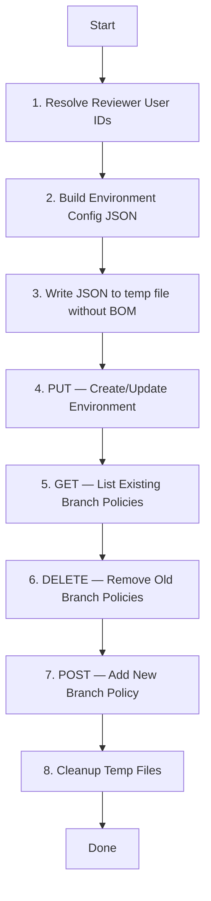

# GitHub Environment Setup — Technical Documentation

## 1. Overview

This toolkit automates the provisioning of **GitHub Deployment Environments** for repositories migrated from Azure DevOps to GitHub Enterprise. It configures environment protection rules, approval gates, and branch deployment policies using the GitHub REST API via the `gh` CLI.

### Scripts Included

| Script | Purpose | Default Environment | Default Branch |
|---|---|---|---|
| `setup-env-dev.ps1` | Provision the **Development** environment | `development` | `develop` |
| `setup-env-qa.ps1` | Provision the **QA** environment | *(must be passed)* | *(must be passed)* |

### Key Difference

| Feature | `setup-env-dev.ps1` | `setup-env-qa.ps1` |
|---|---|---|
| Default values for env/branch | ✅ Yes (`development` / `develop`) | ❌ No (all mandatory) |
| Duplicate branch policy guard | ✅ Yes (cleans old policies before adding) | ❌ No (creates duplicates on re-run) |
| Re-run safe (idempotent) | ✅ Fully | ⚠️ Partially (environment is safe, branch policy duplicates) |

---

## 2. Prerequisites

| Requirement | Details |
|---|---|
| **GitHub CLI (`gh`)** | Must be installed and authenticated. [Install guide](https://cli.github.com/) |
| **Authentication** | `gh auth login` completed, or `GH_TOKEN` environment variable set with a valid PAT |
| **PAT Scopes** | `repo` (full control), `read:user` |
| **Repository Admin Access** | The authenticated user must have **Admin** role on the target repository |
| **PowerShell** | Version 5.1+ (Windows) or PowerShell 7+ (cross-platform) |

---

## 3. Parameter Reference

### `setup-env-dev.ps1`

| Parameter | Required | Type | Default | Description |
|---|---|---|---|---|
| `-GHOrg` | ✅ Yes | `string` | — | GitHub organization or owner name |
| `-GHRepo` | ✅ Yes | `string` | — | GitHub repository name |
| `-EnvName` | ❌ No | `string` | `"development"` | Name of the environment to create |
| `-BranchName` | ❌ No | `string` | `"develop"` | Branch allowed to deploy to this environment |
| `-ReviewerUsernames` | ❌ No | `string[]` | `@()` (empty) | GitHub usernames who must approve deployments |
| `-WaitTimer` | ❌ No | `int` | `0` | Minutes to wait after approval before deployment starts |

### `setup-env-qa.ps1`

| Parameter | Required | Type | Default | Description |
|---|---|---|---|---|
| `-GHOrg` | ✅ Yes | `string` | — | GitHub organization or owner name |
| `-GHRepo` | ✅ Yes | `string` | — | GitHub repository name |
| `-EnvName` | ✅ Yes | `string` | — | Name of the environment to create |
| `-BranchName` | ✅ Yes | `string` | — | Branch allowed to deploy to this environment |
| `-ReviewerUsernames` | ❌ No | `string[]` | `@()` | GitHub usernames who must approve deployments |
| `-WaitTimer` | ❌ No | `int` | `0` | Minutes to wait after approval before deployment starts |

---

## 4. Usage Examples

### Development Environment — Minimal (No Approvals)

```powershell
.\setup-env-dev.ps1 -GHOrg "MyOrg" -GHRepo "MyRepo"
```

> Creates environment `development`, locked to `develop` branch, no approval required.

### Development Environment — With Reviewer

```powershell
.\setup-env-dev.ps1 -GHOrg "MyOrg" -GHRepo "MyRepo" `
    -ReviewerUsernames @("john-doe", "jane-smith") `
    -WaitTimer 5
```

> Creates environment `development` with 2 required approvers and a 5-minute wait after approval.

### QA Environment

```powershell
.\setup-env-qa.ps1 -GHOrg "MyOrg" -GHRepo "MyRepo" `
    -EnvName "qa" -BranchName "release" `
    -ReviewerUsernames @("lead-dev")
```

> Creates environment `qa`, locked to `release` branch, with 1 required approver.

### Custom Environment (Using Dev Script)

```powershell
.\setup-env-dev.ps1 -GHOrg "MyOrg" -GHRepo "MyRepo" `
    -EnvName "staging" -BranchName "main"
```

> Creates a `staging` environment locked to `main` — the defaults are overridden.

---

## 5. Execution Flow

The script executes the following steps in order:



### Step-by-Step Breakdown

| Step | Action | Details |
|---|---|---|
| **1** | Resolve reviewer IDs | Calls `GET /users/{username}` for each reviewer to get their numeric GitHub ID |
| **2** | Build config | Constructs a hashtable with `wait_timer`, `deployment_branch_policy`, and optionally `reviewers` |
| **3** | Write BOM-free JSON | Uses `[System.IO.File]::WriteAllText()` instead of `Out-File` to avoid the UTF-8 BOM that causes HTTP 400 errors |
| **4** | Create/update environment | Calls `PUT /environments/{env}` — idempotent, safe to re-run |
| **5** | List existing policies | Calls `GET /deployment-branch-policies` to find any existing rules |
| **6** | Delete old policies | Calls `DELETE /deployment-branch-policies/{id}` for each — prevents duplicates |
| **7** | Add branch policy | Calls `POST /deployment-branch-policies` to lock deployments to the specified branch |
| **8** | Cleanup | Removes temporary JSON files from `%TEMP%` |

> [!IMPORTANT]
> **Step 3 (BOM-free JSON)** is critical. PowerShell's default `Out-File` and `Set-Content` cmdlets write a UTF-8 BOM (Byte Order Mark) which causes the GitHub API to return `HTTP 400 Bad Request`. The script uses `[System.IO.File]::WriteAllText()` to avoid this.

---

## 6. GitHub REST API Reference

### API Version

All calls use the header:
```
Accept: application/vnd.github+json
```

This targets the **latest stable** GitHub REST API. To pin a specific version, add:
```
X-GitHub-Api-Version: 2022-11-28
```

`2022-11-28` is the current latest version as of this documentation.

### APIs Used

| # | HTTP Method | Endpoint | Purpose | Documentation |
|---|---|---|---|---|
| 1 | `GET` | `/users/{username}` | Look up a user's numeric ID from their username | [Get a user](https://docs.github.com/en/rest/users/users#get-a-user) |
| 2 | `PUT` | `/repos/{owner}/{repo}/environments/{environment_name}` | Create or update a deployment environment with protection rules | [Create or update an environment](https://docs.github.com/en/rest/deployments/environments#create-or-update-an-environment) |
| 3 | `GET` | `/repos/{owner}/{repo}/environments/{environment_name}/deployment-branch-policies` | List all branch policies for an environment | [List deployment branch policies](https://docs.github.com/en/rest/deployments/branch-policies#list-deployment-branch-policies) |
| 4 | `DELETE` | `/repos/{owner}/{repo}/environments/{environment_name}/deployment-branch-policies/{branch_policy_id}` | Delete a specific branch policy | [Delete a deployment branch policy](https://docs.github.com/en/rest/deployments/branch-policies#delete-a-deployment-branch-policy) |
| 5 | `POST` | `/repos/{owner}/{repo}/environments/{environment_name}/deployment-branch-policies` | Create a new branch deployment policy | [Create a deployment branch policy](https://docs.github.com/en/rest/deployments/branch-policies#create-a-deployment-branch-policy) |

### Request/Response Examples

#### PUT — Create/Update Environment

**Request Body:**
```json
{
  "wait_timer": 0,
  "reviewers": [
    { "type": "User", "id": 12345678 }
  ],
  "deployment_branch_policy": {
    "protected_branches": false,
    "custom_branch_policies": true
  }
}
```

**Key Fields:**

| Field | Type | Description |
|---|---|---|
| `wait_timer` | `integer` | Minutes (0–43200) to wait after approval before deploying |
| `reviewers` | `array` | List of users/teams who must approve. Omit for no approval gate |
| `reviewers[].type` | `string` | `"User"` or `"Team"` |
| `reviewers[].id` | `integer` | Numeric GitHub ID of the user or team |
| `deployment_branch_policy.protected_branches` | `boolean` | `true` = only protected branches can deploy |
| `deployment_branch_policy.custom_branch_policies` | `boolean` | `true` = only branches matching custom policies can deploy |

#### POST — Create Branch Policy

**Request Body:**
```json
{
  "name": "develop"
}
```

| Field | Type | Description |
|---|---|---|
| `name` | `string` | Branch name or pattern (supports `*` wildcards, e.g. `release/*`) |

### Required Permissions

| Scope / Role | Why It's Needed |
|---|---|
| PAT scope: `repo` | Full control of repository settings including environments |
| PAT scope: `read:user` | Resolve GitHub usernames to numeric user IDs |
| Repository role: **Admin** | Only admins can create/manage deployment environments and protection rules |

---

## 7. Azure DevOps Pipeline Integration

The scripts can be executed from an Azure DevOps pipeline using the included `deployment-pipeline.yml`:

```yaml
trigger: none

pool:
  vmImage: 'windows-latest'

variables:
  - group: environment_set_up

steps:
  - checkout: self

  - task: PowerShell@2
    displayName: 'Run QA Environment Setup Script'
    inputs:
      filePath: '$(Build.SourcesDirectory)/setup-env-qa.ps1'
      arguments: >
        -GHOrg "$(GH_Org)"
        -GHRepo "$(GHRepo)"
        -EnvName "$(EnvName)"
        -BranchName "$(BranchName)"
        -ReviewerUsernames "$(ReviewerUsernames)"
        -WaitTimer $(WaitTimer)

    env:
      GH_TOKEN: $(GH_PAT)
```

### Variable Group: `environment_set_up`

The pipeline expects the following variables to be defined in the `environment_set_up` variable group:

| Variable | Example Value | Secret? |
|---|---|---|
| `GH_Org` | `First-Devops-organisation` | No |
| `GHRepo` | `my-app-repo` | No |
| `EnvName` | `qa` | No |
| `BranchName` | `release` | No |
| `ReviewerUsernames` | `varsha-patilyash` | No |
| `WaitTimer` | `5` | No |
| `GH_PAT` | `ghp_xxxxxxxxxxxx` | ✅ **Yes** |

> [!CAUTION]
> `GH_PAT` must be stored as a **secret variable** in Azure DevOps. Never commit PATs to source control.

---

## 8. Idempotency & Re-Run Behavior

| Operation | API Method | Re-run Behavior | Safe? |
|---|---|---|---|
| Create/update environment | `PUT` | Overwrites with same values | ✅ Safe |
| Resolve user IDs | `GET` | Returns same ID | ✅ Safe |
| Delete old branch policies | `DELETE` | Removes stale entries | ✅ Safe |
| Add branch policy | `POST` | Creates new entry (after cleanup) | ✅ Safe |
| Temp file cleanup | `Remove-Item` | Silently skips if missing | ✅ Safe |

> [!NOTE]
> The `setup-env-dev.ps1` script is **fully idempotent** — it cleans old branch policies before adding new ones, so re-running produces the exact same result every time.
>
> The `setup-env-qa.ps1` script does **not** clean old policies. Re-running it will create **duplicate branch policy entries**. Consider adding the cleanup step from the dev script.

---

## 9. Troubleshooting

| Issue | Cause | Fix |
|---|---|---|
| `HTTP 400 Bad Request` on environment creation | UTF-8 BOM in JSON file | Already handled — the script uses `[System.IO.File]::WriteAllText()` instead of `Out-File` |
| `HTTP 404 Not Found` | Repository doesn't exist, or PAT lacks `repo` scope | Verify org/repo name and PAT permissions |
| `HTTP 403 Forbidden` | User is not a repository Admin | Grant Admin role to the authenticated user |
| `HTTP 422 Unprocessable Entity` on branch policy | Environment `custom_branch_policies` is set to `false` | Ensure `custom_branch_policies = $true` in the config |
| `Could not find user 'xxx'` | Typo in username, or user doesn't exist on GitHub | Verify the username at `https://github.com/{username}` |
| `gh: command not found` | GitHub CLI not installed | Install from https://cli.github.com/ |
| `gh: Not logged in` | No active `gh` session and no `GH_TOKEN` | Run `gh auth login` or set `$env:GH_TOKEN` |

---

## 10. File Inventory

```
envsetup/
├── setup-env-dev.ps1          # Development environment setup (idempotent)
├── setup-env-qa.ps1           # QA environment setup
└── deployment-pipeline.yml    # Azure DevOps pipeline to run the scripts
```
