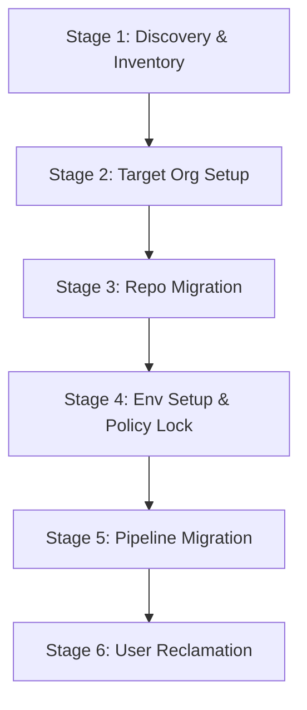

# Migrating from Azure DevOps to GitHub Enterprise: The Complete 6-Stage Framework

*How we migrated repositories, pipelines, environments, teams, and user histories at scale with zero disruption.*

---

In the modern enterprise, standardizing on a single DevSecOps platform is a major milestone. For many organizations, this means migrating from **Azure DevOps (ADO)** to **GitHub Enterprise (GHE)**. 

But anyone who has run a migration knows it is **never** as simple as `git clone` and `git push`. A production-grade migration requires moving:
1. **Source Code & History:** Preserving branches, tags, and commits.
2. **Teams & Permissions:** Rebuilding nested ADO teams as GitHub teams.
3. **Environments & Policies:** Setting up environments, branch policies, and manual approvals.
4. **CI/CD Pipelines:** Translating ADO build/release pipelines to GitHub Actions.
5. **User Identities:** Reclaiming historical commits so they attribute to the correct users in GHE.

To address these challenges, we built a **6-Stage Enterprise Migration Framework**, complete with automation scripts and pipelines. This post walks you through the entire framework and the code that makes it work.

---

## The 6-Stage Migration Lifecycle

We break the migration process down into six distinct phases:



Let's dive into each stage and look at the actual code scripts.

---

### Stage 1: Automated Discovery & Resource Inventory

Before writing a single migration command, you need to know what you are migrating. We developed a comprehensive discovery script, [inventory-assets.ps1](file:///C:/Users/varsha.patil/.gemini/antigravity/scratch/paper/Inventory/inventory-assets.ps1), which queries the Azure DevOps REST APIs and outputs:
- A detailed JSON report cataloging all projects, repos, classic/YAML pipelines, teams, and service connections.
- Clean CSV summaries for quick planning.
- An interactive **HTML Dashboard** that highlights migration blockers.

#### Crucial Discovery Blockers:
- **Large Repositories (>1 GB):** Require specialized migration monitoring.
- **Oversized Repositories (>40 GB):** These are **blocked** from the standard GitHub Enterprise Importer (GEI) and require pre-migration history scrubbing (e.g., using `git-filter-repo` to remove large binaries).

This phase is executed via our asset scanning runbooks, which programmatic query the ADO endpoints to dynamically generate migration reports.

---

### Stage 2: Target Organization Setup & Team Mapping

In GitHub, you want teams to mirror your ADO structures. However, ADO has a flat project structure, whereas GitHub uses a flat Organization structure with nested teams.

Our setup process involves:
1. **Exporting ADO Teams:** Crawling ADO projects to pull teams and members.
2. **Curating Mappings:** Editing [team-mappings.json](file:///C:/Users/varsha.patil/.gemini/antigravity/scratch/paper/set-up-org/config/team-mappings.json) to define parent-child relationships in GitHub.
3. **Automated Syncing:** A pipeline, [setup-github-org-pipeline.yml](file:///C:/Users/varsha.patil/.gemini/antigravity/scratch/paper/set-up-org/setup-github-org-pipeline.yml), that uses manual validation gates before using the GitHub API to provision teams and add members.

These hierarchies are mapped using standard configuration configurations in the repository, making it easy to model nested relations and default access scopes programmatically.

---

### Stage 3: Repository Migration & Secret Scanning

Repository migration is handled using the **GitHub Enterprise Importer (GEI)** CLI tool. Our batch migration script, [migrate-batch.ps1](file:///C:/Users/varsha.patil/.gemini/antigravity/scratch/paper/repo-migration/03-migrate/migrate-batch.ps1), automatically:
1. Performs a **Secret Scan** using GitHub Advanced Security (GHAS) pre-migration hooks.
2. Migrates the repository using `gh gei migrate-repo`.
3. Validates the migration by comparing commit logs and branch counts between ADO and GHE.

Our migration scripts execute these migration runs sequentially, invoking the primary GEI CLI command under the hood:

```bash
gh gei migrate-repo \
    --ado-pat "$ADO_PAT" \
    --github-pat "$GH_PAT" \
    --ado-org "$ADO_ORG" \
    --ado-team-project "$ADO_PROJECT" \
    --ado-repo "$REPO_NAME" \
    --github-org "$GH_ORG" \
    --github-repo "$REPO_NAME"
```

After the run, the script validates migration status by checking commit checksums and branch symmetries at each step.

---

### Stage 4: Environment Provisioning & Policy Configuration

GitHub Environments are a powerful way to secure deployments, but manually configuring them for hundreds of repositories is error-prone. 

We automated environment setup using a script, [setup-env-multi.ps1](file:///C:/Users/varsha.patil/.gemini/antigravity/scratch/paper/env-set-up/setup-env-multi.ps1), which reads a CSV ([repos.csv](file:///C:/Users/varsha.patil/.gemini/antigravity/scratch/paper/env-set-up/repos.csv)) and applies environment settings programmatically using the GitHub CLI:

1. **Creates Environments** (e.g., `development`, `qa`, `prod`).
2. **Configures Reviewer Gates:** Maps GitHub IDs to environments as mandatory approvers.
3. **Locks Deployment Branch Policies:** Restricts deployments to specific branches (e.g., `prod` deployments can only trigger from `main`).

The configuration rules are applied modularly, enabling you to define gates and runbook mappings dynamically without modifying the main script core.

---

### Stage 5: Pipeline Migration & Actions Refactoring

Translating CI/CD pipelines from ADO (especially Classic UI Release pipelines) to GitHub Actions is the most labor-intensive step. 

We address this with a refactoring accelerator that maps pipelines to target repositories. YAML build configurations are parsed, while classic release definitions are exported and mapped to modern, reusable GitHub Actions workflows.

We structure our target Actions using:
- **Reusable Workflows:** To standardize security scans, dependency audits, and builds.
- **Environment Environments:** Leveraging the reviewer gates and protection rules configured in Stage 4.

---

### Stage 6: User Reclamation & History Attribution

When a repository is migrated using GEI, commits are temporarily attributed to **"Mannequins"**—placeholder user identities—because active mapping between ADO emails and GitHub accounts hasn't happened.

To prevent losing history and authorship, we run an automated reclaim pipeline, [azure-pipeline-reclaim.yaml](file:///C:/Users/varsha.patil/.gemini/antigravity/scratch/paper/usser-reclaim/azure-pipeline-reclaim.yaml). The workflow:
1. Generates a list of all mannequins in the organization.
2. Matches mannequins against our mapped users in [user-mappings.csv](file:///C:/Users/varsha.patil/.gemini/antigravity/scratch/paper/repo-migration/config/user-mappings.csv).
3. Reclaims the mannequins in bulk, sending invitations to target GitHub users to link their past commit history to their new active account.

The pipeline targets these placeholder mappings, executing the standard GEI mannequin reclamation command:

```bash
gh gei reclaim-mannequin \
    --github-org "$GH_ORG" \
    --csv "$RECLAIM_CSV" \
    --force
```

This invites target users to claim their historical commit records, restoring full contributor attribution.

---

## Lessons Learned from the Trenches

1. **Map Users Early:** Never run a repository migration without a completed mapping file. Attributing commits correctly from day one is much easier than fixing hundreds of mannequins post-migration.
2. **Watch the 40 GB Hard Ceiling:** Large binaries in git history will crash the GEI importer. Identify these in Stage 1 and use `git-filter-repo` to clean up the histories of oversized repositories.
3. **Clean Up Branch Policies Before Re-running:** If you re-run environment creation scripts, make sure to delete old deployment branch policies first to avoid duplicates.

---

## Conclusion

Migrating from Azure DevOps to GitHub Enterprise is an architectural shift. By moving away from manual migrations and implementing a **6-Stage Automated Lifecycle**, we ensured consistent team permissions, secure environment locks, zero lost commit history, and a seamless transition for developers.

*What challenges have you run into during platform migrations? Let's discuss in the comments below!*
