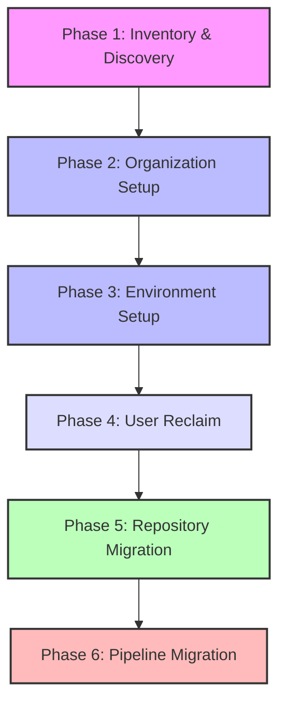
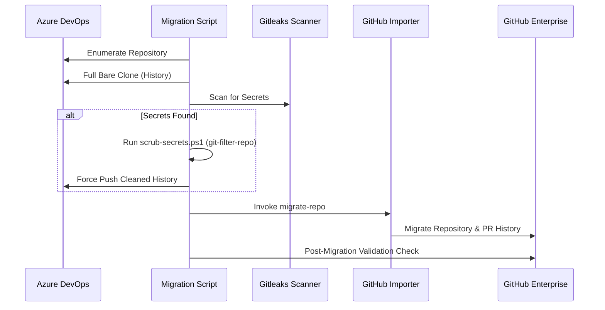

# Enterprise-Grade Migration: A Comprehensive Guide to Migrating from Azure DevOps to GitHub

*A detailed architectural blueprint for migrating repositories, teams, users, environments, and pipelines from Azure DevOps to GitHub Enterprise.*

---

## Introduction

As enterprises scale, the need for unified developer platforms becomes critical. GitHub Enterprise (GHE) has emerged as the industry standard for modern software development. However, migrating an entire enterprise organization from Azure DevOps (ADO) to GitHub is a complex undertaking. It is not just about copying Git repositories; it involves mapping team structures, managing secrets, setting up environment permissions, reclaiming developer identities, and translating build and release pipelines.

This technical paper describes a comprehensive **ADO-to-GitHub Migration Framework**—a production-ready migration architecture structured into six distinct phases. We will explore the technical design of each phase, detailing how scripts and automation templates work together to ensure a zero-data-loss, secure, and fully validated migration.

---

## The Migration Lifecycle

An enterprise migration cannot be executed as a single, monolithic step. Instead, it must follow a structured lifecycle to ensure security, compliance, and validation.

---

## Phase 1: Asset Inventory & Discovery

Before moving any data, you must understand the current state of your Azure DevOps organization. Without an accurate inventory, it is impossible to estimate migration timelines or identify potential roadblocks.

### Core Automation:
*   **`Inventory/inventory-assets.ps1`**: Enumerates all Azure DevOps projects, repositories, build pipelines, release pipelines, service connections, and user permissions.
*   **`Inventory/inventory.yaml`**: Configures discovery parameters such as filters, exclusion lists, and targets.

### Key Activities:
1.  **Repository Audit**: Enumerate all repositories, cataloging their sizes and default branches. 
2.  **Pipeline Mapping**: Document all build and release pipelines, noting their trigger types and dependencies.
3.  **Roadblock Identification**: Flag repositories larger than **40 GB** (the recommended limit for the GitHub Enterprise Importer, or GEI) and detect Git LFS usage, which requires special handling because GEI does not migrate LFS objects.

---

## Phase 2: GitHub Organization Setup & Team Mapping

A successful migration preserves the organization's collaborative structure. This phase focuses on provisioning the GitHub organization's structure, teams, and access levels before migrating repositories.

### Core Automation:
*   **`set-up-org/setup-github-org-pipeline.yml`**: Automates team creation, membership mapping, and permissions setup in GitHub.
*   **`set-up-org/01-prep/export-ado-teams.ps1`**: Queries Azure DevOps for existing team memberships, security groups, and access control lists.
*   **`set-up-org/01-prep/team.ps1`**: Interfaces with the GitHub API to provision corresponding GitHub Teams.
*   **`set-up-org/config/team-mappings.json`**: Explicitly maps ADO groups to GitHub Teams.

### Key Activities:
*   **Hierarchical Team Setup**: Map ADO project teams to GitHub team hierarchies (e.g., Parent Teams, Sub-teams).
*   **Access Control**: Set default repository permissions (Read, Write, Admin) for teams based on their legacy ADO permissions.

---

## Phase 3: Environment Setup & Variable Configuration

Enterprise applications rely on environments (Dev, QA, Preprod, Prod) to govern deployments. In Azure DevOps, these are managed via Service Connections and Environment checks. In GitHub, these translate to **GitHub Environments**, **Secrets**, and **Variables**.

### Core Automation:
*   **`env-set-up/setup-env-multi.ps1`**: Batch provisions environments, variables, and secrets across multiple target GitHub repositories.
*   **`env-set-up/repos.csv`**: A repository manifest defining which environments and variables should be assigned to which repositories.
*   **`env-set-up/deployment-pipeline.yml`**: Automates the environment configuration stage.

### Key Activities:
*   **Environment Provisioning**: Create corresponding target GitHub Environments (e.g., `development`, `production`).
*   **Variable Injection**: Populate environment-specific non-secret configurations (e.g., API endpoints, region settings).
*   **Secret Management**: Inject environment-specific secrets (e.g., database passwords, AWS roles) without exposing them in code.

---

## Phase 4: User Identity Reclaim

Migrating commits without mapping user identities results in detached commit histories (e.g., commits associated with legacy active directory emails rather than active GitHub usernames).

### Core Automation:
*   **`usser-reclaim/azure-pipeline-reclaim.yaml`**: Coordinates the mapping and reclaim process.
*   **`usser-reclaim/repo-migration/config/user-mappings.csv`**: Maps Active Directory / ADO emails to GitHub usernames.

### Key Activities:
*   **Mapping Verification**: Ensure every active contributor has mapped their ADO identity to their GitHub Enterprise username.
*   **History Attribution**: Map commit history during repository migration so that commits and pull request history are correctly attributed to the proper GitHub profiles.

---

## Phase 5: Repository Migration & Validation

This is the core phase of the framework, executing repository migration using the GitHub Enterprise Importer (GEI) CLI, auditing sizes, scanning for secrets, and verifying integrity.

### Core Automation:
*   **`repo-migration/03-migrate/migrate-batch.ps1`**: Orchestrates batch migrations in parallel.
*   **`repo-migration/03-migrate/migrate-single.ps1`**: Migrates a single repository and generates post-migration metrics.
*   **`repo-migration/01-discover/scan-secrets.ps1`**: Clones repositories and runs `gitleaks` to find exposed secrets before pushing to GitHub.
*   **`repo-migration/02-prep/scrub-secrets.ps1`**: Runs `git-filter-repo` to scrub history if secrets are detected.
*   **`repo-migration/04-validate/validate-migration.ps1`**: Reconciles the migrated GitHub repository against the ADO source (checking branches, tags, PRs, visibility, and branch protection).

### Key Activities:
*   **Secrets Scanning & Scrubbing**: Running a pre-migration scan is critical. Migrating history containing credentials into GitHub triggers automatic alert blocks. The framework automatically detects and scrubs these credentials using `git-filter-repo`.
*   **Paralleled Batching**: Support for repository renaming/mapping during migrations via `config/repo-migration-config.json`.
*   **Reconciliation & Verification**: The validation script compares commit counts, branch names, tags, PR counts, and visibility (Private/Internal/Public) to guarantee that zero data was lost during transport.

---

## Phase 6: Pipeline Migration

Build and release pipelines represent the operational heartbeat of the developer workflow. Translating Azure Pipelines (`azure-pipelines.yml`) to GitHub Actions (`.github/workflows/*.yml`) is the final step.

### Core Automation:
*   **`pipeline-migration/migration.yaml`**: Defines pipeline mappings, environment secrets, and configuration.
*   **`pipeline-migration/migration-accelerator/`**: Tools and translation templates designed to help rewrite ADO tasks to GitHub Actions (e.g., mapping ADO variables to GitHub envs, tasks like `MSBuild` to action commands, and service connections to AWS/Azure credentials actions).

### Key Activities:
*   **Syntax Translation**: Map ADO triggers, jobs, steps, and tasks to GitHub Action steps, jobs, and runner pools.
*   **Secret Mapping**: Map ADO Variable Groups to GitHub Secrets.
*   **Workflow Verification**: Run translated workflows in a dry-run fashion to verify deployment steps and compile checks.

---

## Conclusion & Best Practices

Migrating an enterprise from Azure DevOps to GitHub Enterprise is a multi-dimensional challenge. By adopting the structured approach detailed in this framework, organizations can:
*   Ensure **zero data loss** through automatic validation reports.
*   Prevent **security incidents** by scanning and scrubbing secret histories before they are uploaded.
*   Preserve **developer productivity** by maintaining clean team, identity, and pipeline mappings.
*   Mitigate **configuration drift** by templating infrastructure and environments.

Using parameterization and modular configurations ensures that the migration process is repeatable, audit-compliant, and secure.
