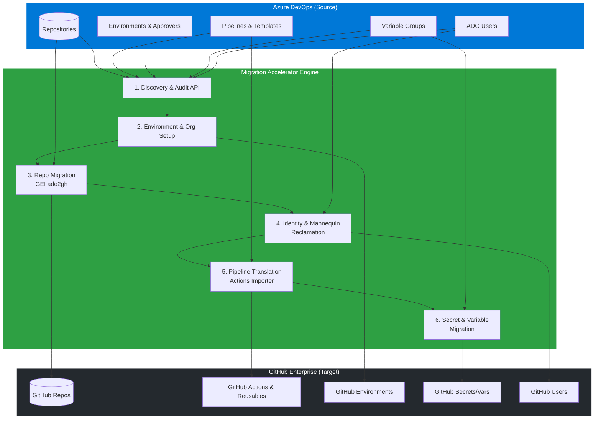

# Architecting an End-to-End Azure DevOps to GitHub Migration: A Comprehensive Guide

Migrating from Azure DevOps (ADO) to GitHub is rarely just about moving source code. A true enterprise-scale migration requires transferring repositories, pipelines, environments, variable groups, and user identities while ensuring continuity. 

Having recently engineered a full-scale migration using the **GitHub Enterprise Importer (GEI)** and the `ado2gh` extension, I wanted to share the theoretical architecture and workflow of our automated migration accelerator. In future articles, I will dive deep into the specific implementation details of each pipeline.

Here is the high-level blueprint for an end-to-end ADO to GitHub migration.

## Migration Architecture



---

## Prerequisites
Before triggering any automation, you must ensure your orchestrator (or local machine) is equipped with the necessary tooling and authentication:

1. **GitHub CLI (`gh`):** The foundational command-line tool.
2. **GEI Extension:** Installed via `gh extension install github/gh-ado2gh`.
3. **Actions Importer Extension:** Installed via `gh extension install github/gh-actions-importer`.
4. **Authentication Tokens:** 
   * **ADO PAT:** A Personal Access Token from Azure DevOps with permissions to read code, pipelines, and variable groups.
   * **GitHub PAT:** A token with `repo`, `workflow`, and `admin:org` (if creating repos/environments) scopes.

---

## 1. Inventory & Discovery
Before moving any data, you must understand the existing footprint. We built an automated discovery phase utilizing Azure DevOps REST APIs (`api-version=7.1`) to pull a complete inventory. 

**What we audit:**
* **Repositories:** Counting repos, calculating sizes, and identifying default branches.
* **Pipelines:** Identifying classic release definitions vs. YAML builds.
* **Environments & Variable Groups:** Extracting deployment environments, variable groups, and tracking secret counts.
* **Teams & Users:** Identifying all active members to map identities later.

This data acts as the source of truth for the migration batches, allowing us to accurately predict timelines and identify potential blockers before they happen.

---

## 2. Organization & Environment Setup
GitHub handles environments and branch protections slightly differently than ADO. Before the code lands, the destination must be prepared. 

Through automated PowerShell scripts (using the `gh api`), we programmatically provision the GitHub target state:
* **Environment Configuration:** Creating environments (e.g., `dev`, `qa`, `prod`) in GitHub.
* **Protection Rules:** Setting up deployment branch policies and configuring reviewer gates (mapping ADO approvers to GitHub user IDs).
* **Timers:** Applying wait timers to mimic ADO deployment delays.

By setting this up first, we guarantee that once pipelines are migrated, they have the correct security boundaries ready to receive them.

---

## 3. Repository Migration
The core of the source code move is powered by the **GitHub Enterprise Importer (GEI)** CLI (`gh ado2gh`). 

Our migration pipeline operates in stages:
1. **Dry-Run:** Validates that the migration *can* happen without actually moving data. 
2. **Batch or Single Execution:** Orchestrates the `migrate-repo` commands for one or multiple repositories at a time.
3. **Validation:** Checks that all branches, tags, and PR histories successfully made it across.

Using GEI ensures that pull request history, commits, and metadata are preserved, maintaining the historical context of the codebase.

**Under the Hood:** The core command powering this phase is the GitHub CLI with the GEI extension:
```bash
# Example underlying command for repo migration
gh ado2gh migrate-repo \
  --ado-org "my-ado-org" \
  --ado-team-project "my-project" \
  --ado-repo "my-repo" \
  --github-org "my-gh-org" \
  --github-repo "my-repo" \
  --wait
```

---

## 4. Identity Mapping & User Reclamation (Mannequins)
When historical commits and PRs are migrated, the original ADO users might not have their GitHub accounts linked yet. GitHub creates placeholder accounts called **"Mannequins"** to represent these users.

We designed a dedicated **Reclaim Pipeline** to handle this:
* We generate a `user-mappings.csv` correlating the ADO email to the target GitHub handle.
* The pipeline automatically invokes the GEI `reclaim-mannequin` command.
* This attributes the historical commits, PRs, and comments to the actual developer’s GitHub account, ensuring unbroken contribution graphs.

**Under the Hood:** Once the CSV mapping is generated, the pipeline executes the reclaim command:
```bash
# Example underlying command for mannequin reclamation
gh ado2gh reclaim-mannequin \
  --github-org "my-gh-org" \
  --csv "user-mappings.csv"
```

---

## 5. Pipeline Migration & Reusable Workflows
Migrating ADO Pipelines to GitHub Actions requires translation. We leverage the **GitHub Actions Importer** to audit and convert ADO YAMLs to GitHub Actions workflow syntax.

A critical challenge in pipeline migration is handling ADO templates. We solved this by:
* **Centralizing Templates:** Automatically provisioning a centralized "Reusable Workflows" repository in GitHub.
* **Translation:** Converting ADO templates into GitHub Composite Actions and Reusable Workflows.
* **Rewriting References:** Our pipeline parses the `config.yml` output of the Actions Importer and rewrites the template references so that the migrated consumer workflows correctly point to the new central repository.

**Under the Hood:** The GitHub Actions Importer drives the pipeline translation:
```bash
# Example underlying command for pipeline audit and migration
gh actions-importer audit azure-devops \
  --output-dir "pipeline-audit"

gh actions-importer migrate azure-devops \
  --target-url "https://github.com/my-gh-org/my-repo" \
  --output-dir "pipeline-migrate"
```

---

## 6. Variable Group & Secrets Migration
ADO Variable Groups often contain critical CI/CD configuration data and secrets. These need to be securely mapped to **GitHub Organization/Repository Variables and Secrets**.

Our Phase 3 Secrets Migration extracts non-secret variables from ADO via API and populates them as GitHub Variables. For actual secrets, we inject placeholders or securely prompt for re-entry, ensuring compliance and preventing secret leakage during the transit.

---

## Conclusion
Migrating from ADO to GitHub is a multi-dimensional challenge. By breaking the migration into distinct, automated phases—**Discovery, Environment Setup, Repo Migration, User Reclamation, Pipeline Translation, and Secrets Management**—you can execute seamless, enterprise-scale transitions.

*In my upcoming articles, I will break down each of these phases step-by-step, starting with the exact scripts and pipelines used for Repository Migration and User Reclamation. Stay tuned!*
