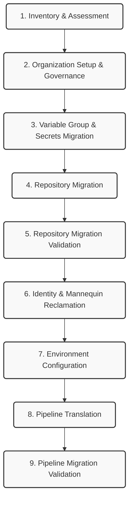

# Architecting an End-to-End Azure DevOps to GitHub Migration: A Comprehensive Guide

As organizations standardize on GitHub Enterprise, migrating from Azure DevOps (ADO) has become a common strategic initiative. However, an enterprise migration involves far more than transferring source code. Pipelines, deployment environments, variable groups, user identities, and governance controls must also be migrated while minimizing operational disruption. 

This article presents an automated migration architecture built using GitHub Enterprise Importer (GEI), GitHub Actions Importer, and custom orchestration pipelines.

## Key Migration Challenges
Before exploring the architecture, it is important to understand why custom orchestration is necessary. Standard tools handle the raw code, but enterprise migrations face several major obstacles:
* **Preserving repository history and pull requests** without losing context.
* **Translating Azure DevOps pipelines to GitHub Actions** accurately.
* **Migrating variable groups and secrets securely** without exposing credentials.
* **Maintaining deployment governance** across environments.
* **Mapping user identities across platforms** to preserve contribution graphs.
* **Handling reusable templates and shared pipeline libraries.**

## Migration Metrics at a Glance
To illustrate the scale of this automated approach, here are approximate metrics from a recent migration execution:

| Metric | Value |
|--------|-------|
| Repositories Migrated | 250 |
| Pipelines Converted | 1,200 |
| Variable Groups Migrated | 400 |
| Users Reclaimed | 800 |
| Migration Duration | 6 Weeks |

*(Note: These figures showcase the power of automation at scale.)*

## Migration Architecture
Here is the blueprint for our ADO to GitHub migration, accurately mapped to our automated execution pipelines. Notice how validation is decoupled and executed immediately after its respective migration phase.

---

## 1. Inventory & Assessment
Before moving any data, you must understand the existing footprint. We built an automated discovery phase utilizing Azure DevOps REST APIs to pull a complete inventory. 

**Risk Classification:**
Based on the extracted data, we categorize repositories to prioritize migration waves:
* **Low Complexity:** Simple repos with few branches and no complex pipelines.
* **Medium Complexity:** Repositories with standard CI/CD and basic service connections.
* **High Complexity:** Repositories with extensive pipeline counts, template dependencies, complex release definitions, and large code sizes.

This data acts as the source of truth, allowing us to accurately predict timelines and identify blockers.

---

## 2. Organization Setup & Governance
GitHub handles organization scaffolding differently than ADO. Before the code lands, the destination must be prepared:
* Establishing organization-wide repository defaults.
* Ensuring SCIM/SSO integration is operational.
* Creating initial teams and mapping ADO project structures to GitHub repository naming conventions.

**Governance & Compliance:**
Instead of configuring security manually, our orchestrator programmatically builds a secure, enterprise-grade environment around the code before developers even log in:
* **Branch Protection Enforcement:** Post-migration automation makes direct API calls to actively lock down the default branch.
* **Compliance Mapping:** A dedicated blueprint ensures ADO's dependency scanning is mapped to **Dependabot alerts**, ADO's secret detection to **GitHub Secret Scanning + Push Protection**, and ADO's branch policies to **GitHub Rulesets** and `CODEOWNERS`.

---

## 3. Variable Group & Secrets Migration
ADO Variable Groups often contain critical CI/CD configuration data and secrets. These need to be securely mapped to **GitHub Organization/Repository Variables and Secrets** before environments and pipelines run.

Our automation extracts non-secret variables from ADO via API and populates them as GitHub Variables. For actual secrets, we inject placeholders or securely prompt for re-entry, ensuring compliance and preventing secret leakage during transit.

---

## 4. Repository Migration
The core of the source code move is powered by the **GitHub Enterprise Importer (GEI)** CLI. Our pipeline operates in logical stages: Discover, Review, and Migrate.

By orchestrating GEI in an automated fashion, we ensure that pull request history, commits, and metadata are perfectly preserved, maintaining the historical context of the codebase.

---

## 5. Repository Migration Validation
A migration is incomplete without proof of integrity. Immediately following the repository move, our orchestration triggers a dedicated validation layer:
* **Repository existence checks:** Verifying the payload landed correctly.
* **Branch and tag verification:** Ensuring no missing branches or missing tags.
* **Commit history verification:** Validating that the latest commit is reachable.
* **Pull request counts:** Ensuring historical PRs correctly mapped over.

---

## 6. Identity & Mannequin Reclamation
When historical commits and PRs are migrated, the original ADO users might not have their GitHub accounts linked yet. GitHub creates placeholder accounts called **"Mannequins"** to represent these users.

We designed a dedicated Reclaim Pipeline to handle this:
* We generate a mapping correlating the ADO email to the target GitHub handle.
* The pipeline automatically invokes the reclamation process, mapping historical commits to the actual developer’s GitHub account.

---

## 7. Environment Configuration
With the code in place, we programmatically provision the GitHub target state for deployment targets based on a configuration matrix:
* Environment Creation (e.g., `dev`, `qa`, `prod`).
* Branch Deployment Policies (locking deployments to specific branches).
* Required Reviewers Configuration (resolving GitHub User IDs).
* Deployment Wait Timers to mimic ADO logic.

---

## 8. Pipeline Translation
Migrating ADO Pipelines to GitHub Actions requires translation. We leverage the **GitHub Actions Importer** to audit and convert ADO YAMLs to GitHub Actions workflow syntax.

**Common Translation Mappings:**
| Azure DevOps | GitHub Actions |
|-------------|----------------|
| Variable Groups | Repository/Organization Variables |
| Service Connections | Secrets + OIDC |
| Templates | Reusable Workflows / Composite Actions |
| Deployment Jobs | Environments |
| Approval Gates | Required Reviewers |

A critical challenge is handling ADO templates. We solve this by automatically provisioning a centralized "Reusable Workflows" repository and rewriting references in consumer workflows to point to the new location.

---

## 9. Pipeline Migration Validation
Immediately following the pipeline conversion, a second dedicated validation phase executes to ensure CI/CD integrity:
* **Workflow validation:** Syntax checking the translated GitHub Actions workflows.
* **Dependency mapping checks:** Ensuring secrets, variables, and service connections are referenced correctly.
* **Reusable workflow verification:** Confirming the extracted templates are correctly referenced by their consumer workflows.

---

## Lessons Learned
Having navigated this process at scale, here are our top practical insights:
* **Complete inventory before migrating any repository.** Blind migrations always lead to broken dependencies.
* **Standardize GitHub organization structure early.** Trying to apply governance retroactively is painful.
* **Resolve identity mappings before cutover.** It is much easier to claim mannequins immediately after repo migration.
* **Migrate secrets separately from configuration.** This maintains strict security boundaries.
* **Validate pipeline translations manually for complex templates.** Highly customized ADO logic often requires a human touch.

---

## Conclusion
Successful Azure DevOps to GitHub migrations require a repeatable and automated approach that extends beyond repository transfer. By combining GitHub Enterprise Importer, GitHub Actions Importer, and custom orchestration pipelines, organizations can migrate repositories, identities, environments, and CI/CD assets at scale while preserving governance and developer productivity. 

The framework described here provides a foundation for executing large-scale migrations in a predictable and auditable manner. In upcoming articles, I will dive deep into the specific implementation details of each phase. Stay tuned!
